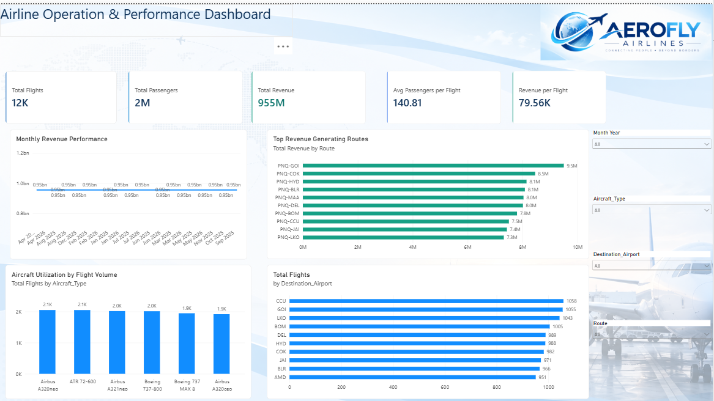

  <h1>✈️ Airline Operations & Performance Analytics</h1>

  <h3>Interactive Power BI Dashboard | Business Intelligence | Data Analytics</h3>

  

    Transforming airline operational data into meaningful
    insights through interactive dashboards, KPI monitoring,
    and business intelligence.
  

  

    
    
    
    
  

  

    <a href="#-dashboard-preview">Dashboard Preview</a> •
    <a href="#-project-overview">Overview</a> •
    <a href="#-business-objectives">Objectives</a> •
    <a href="#-tools--technologies">Technologies</a> •
    <a href="#-author">Author</a>
  

---

<h2>📌 Project Overview</h2>

The <b>Airline Operations & Performance Analytics Dashboard</b>
is an interactive Power BI project developed to analyze airline
operational performance and provide meaningful business insights.

The dashboard focuses on understanding flight operations,
monitoring performance indicators, analyzing operational trends,
and identifying potential areas for improvement.

<b>Project Focus:</b>

- Airline operational performance monitoring
- Flight activity and trend analysis
- KPI reporting and data visualization
- Operational efficiency analysis
- Root cause analysis and business decision-making

---

<h2>🎯 Business Objectives</h2>

The primary objective of this project is to transform airline
operational data into actionable business intelligence.

<b>Key Objectives:</b>

1. Monitor airline operational performance.
2. Analyze monthly flight trends and patterns.
3. Evaluate operational efficiency using KPIs.
4. Identify potential causes of operational challenges.
5. Support data-driven business decisions.
6. Present insights through interactive Power BI dashboards.

---

<h2>📊 Dashboard Preview</h2>

  The Power BI dashboard is organized into three analytical
  sections to support business storytelling and decision-making.

<h2>📊 Dashboard Preview</h2>

  Explore the three interactive Power BI dashboard pages
  designed to analyze airline operational performance.

<!-- DASHBOARD 1 -->
<h3>1️⃣ Airline Operations — Overview</h3>

  

  <i>Figure 1: Airline Operations & Performance Overview</i>

<b>Dashboard Highlights:</b>

<ul>
  <li>Operational performance KPI cards</li>
  <li>Monthly flight trend analysis</li>
  <li>Flight distribution analysis</li>
  <li>Interactive operational insights</li>
</ul>

<!-- DASHBOARD 2 -->
<h3>2️⃣ Methods & Strategies</h3>

  

  <i>Figure 2: Airline Operational Methods & Strategies</i>

<b>Dashboard Highlights:</b>

<ul>
  <li>Operational performance analysis</li>
  <li>Flight activity comparisons</li>
  <li>Efficiency improvement opportunities</li>
  <li>Data-driven business strategies</li>
</ul>

<!-- DASHBOARD 3 -->
<h3>3️⃣ Root Cause Analysis & SWOT</h3>

  

  <i>Figure 3: Root Cause Analysis & SWOT</i>

<b>Dashboard Highlights:</b>

<ul>
  <li>Root cause analysis using a Fishbone Diagram</li>
  <li>Operational challenges and contributing factors</li>
  <li>Strengths, weaknesses, opportunities and threats</li>
  <li>Business improvement recommendations</li>
</ul>

<b>Root Cause Analysis:</b>

- Identify potential operational challenges.
- Examine contributing factors using a Fishbone Diagram.
- Explore possible corrective actions.

<b>Strategic Analysis:</b>

- Strengths
- Weaknesses or Challenges
- Opportunities
- Threats

<b>Business Purpose:</b>

Provide a structured approach to understanding operational
issues and supporting business improvement decisions.

---

<h2>🛠️ Tools & Technologies</h2>

<table>
  <tr>
    <th>Technology</th>
    <th>Purpose</th>
  </tr>
  <tr>
    <td>Power BI Desktop</td>
    <td>Interactive dashboard development</td>
  </tr>
  <tr>
    <td>Power Query</td>
    <td>Data cleaning and transformation</td>
  </tr>
  <tr>
    <td>DAX</td>
    <td>Calculated measures and KPI development</td>
  </tr>
  <tr>
    <td>Microsoft Excel</td>
    <td>Dataset preparation and validation</td>
  </tr>
  <tr>
    <td>Data Visualization</td>
    <td>Performance reporting and storytelling</td>
  </tr>
  <tr>
    <td>Root Cause Analysis</td>
    <td>Operational problem investigation</td>
  </tr>
</table>

---

<h2>🔄 Project Workflow</h2>

  <b>Data Collection</b> 
  ⬇️ 
  <b>Data Cleaning & Transformation</b> 
  ⬇️ 
  <b>Data Modeling</b> 
  ⬇️ 
  <b>DAX Measures & KPI Development</b> 
  ⬇️ 
  <b>Dashboard Development</b> 
  ⬇️ 
  <b>Performance Analysis</b> 
  ⬇️ 
  <b>Business Insights & Recommendations</b>

---

<h2>💡 Analytical Insights & Business Value</h2>

This project demonstrates how airline operational data
can be analyzed to support informed decision-making.

<b>Analytical Areas:</b>

- Understanding changes in flight activity over time
- Comparing operational performance across categories
- Monitoring airline performance indicators
- Exploring operational challenges
- Identifying potential improvement opportunities

<b>Business Value:</b>

The dashboard provides a centralized reporting interface
that can help stakeholders monitor performance, investigate
operational patterns, and communicate analytical findings.

---

<h2>📂 Project Files</h2>

| File | Description |
|------|-------------|
| [Power BI Dashboard](Dashboard/Airline_Operations_Dashboard.pbix) | Interactive Power BI report |
| [Dataset](Dataset/Airline_Operations_Dataset.xlsx) | Source data for analysis |
| [Screenshots](Screenshots/) | Dashboard preview images |
| README.md | Project documentation |

---

<h2>🚀 How to Use This Project</h2>

1. Clone or download this GitHub repository.
2. Install Microsoft Power BI Desktop.
3. Open the `.pbix` file from the Dashboard folder.
4. Explore the dashboard pages.
5. Use available slicers and filters.
6. Analyze airline operational performance.

---

<h2>🎓 Skills Demonstrated</h2>

- Power BI Dashboard Development
- Data Cleaning and Transformation
- DAX Measures and Calculations
- KPI Monitoring and Reporting
- Business Intelligence
- Data Visualization
- Operational Performance Analysis
- Analytical Storytelling
- Root Cause Analysis
- Business Decision Support

---

  <h3>⭐ If you found this project useful, consider starring the repository!</h3>

  
Built with Power BI and a passion for data analytics.

